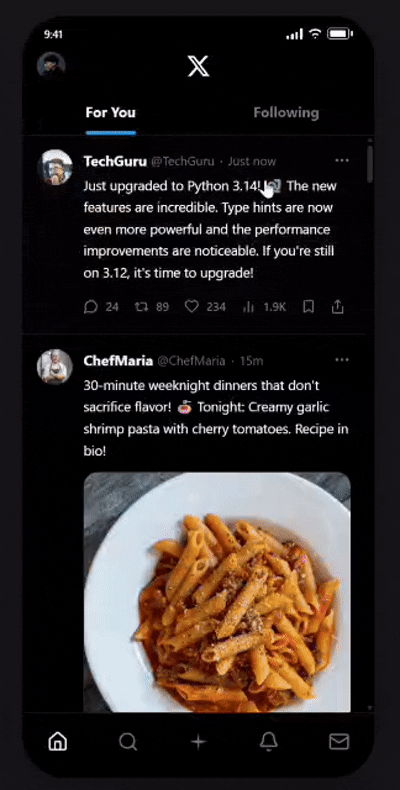

<h1 align="center">X Recall — AI-Powered Bookmark Organization for X</h1>

<p align="center">
  
</p>

X offers bookmark collections in Premium. But organizing requires friction: manually creating folders, choosing categories, moving each tweet. This is why most saves go untouched...the feature exists, but the UX fails.

Users bookmark with intent. X throws that signal away. This is the gap: frictionless organization at save time transforms bookmarks from a junk drawer into a high-intent ad inventory. It also creates switching costs, as users who organize their saves stay.

X Recall proves the concept. Bookmarked tweets classify themselves into smart folders using a three-signal AI engine. Zero clicks. Zero interruption to scroll.

[View Live Prototype](https://x-recall-prototype.vercel.app/)

## The Problem

Fewer than 25% of saved content across read-later platforms is ever reopened. On X, where saves are impulsive and context-dependent, this rate is estimated lower. The failure is not in saving. It is in retrieval. Users already show intent by bookmarking. The product just throws that signal away.

## The AI Enhancement

A three-signal inference engine classifies every tweet the moment it is bookmarked:

* **Signal 1: Correction Learning.** Checks the user's correction history first. If a similar tweet was previously moved to a different folder, the learned category is returned at 0.88 to 0.98 confidence. Persisted across sessions via localStorage.
* **Signal 2: Semantic Analysis.** Keyword dictionary across 12 categories and 100+ domain-specific terms. Matches on tweet content and author name simultaneously.
* **Signal 3: Author Authority.** Bayesian prior from account name. ESPN maps to Sports. BBCNews maps to News. Contributes alongside semantic matching.

Low-confidence classifications (below 75%) route to an Unsorted inbox rather than auto-filing incorrectly. Every manual correction trains the model and adjusts a live trust score.

## Key Features

* Zero-click save: AI classifies and files on bookmark tap
* Confidence scoring with Unsorted inbox for low-confidence saves
* Correction loop: manual moves train the model, persisted across sessions
* Semantic search across all folders simultaneously
* Folder management: create, rename, delete, reorder
* AI explanation sheet: shows matched keywords and confidence
* Trust score system: rises with accepted saves, falls with corrections
* localStorage persistence: bookmarks survive page refresh
* iOS-accurate UI: status bar, Grok nav icon, Following tab, profile drawer
* Demo reset button: wipes localStorage and reloads to seed state

## How It Works

1. User bookmarks a tweet in the feed
2. AI classifies it in under 500ms using three signals
3. Toast confirms: "Saved to Dev Resources, Grok is 84% confident"
4. Tweet lands in the correct folder in Library, zero user input
5. If wrong, user moves it manually and AI learns and corrects itself
6. On next similar tweet, learned category is applied at high confidence

## Why X Should Build This

X's bookmark feature captures 3+ billion intent signals per month. Right now those signals vanish into a junk drawer. Automatic AI classification unlocks three revenue streams: 
1. Intent-based ad placements in organized folders (2–5x CPM premium over feed ads)
2. Reduced churn: Users who organize their saves stay longer and engage more
3. Switching cost: Organized bookmarks lock users into the platform and away from read-later competitors like Pocket and Notion.

The correction learning loop also creates a proprietary dataset: every user correction teaches the model their personal categorization preferences. This data becomes more valuable over time and harder for competitors to replicate.

## 🔄 Production-Grade Cross-Device Sync

Real-time synchronization across browser tabs demonstrating distributed systems design:

* **Instant Cross-Tab Sync**: Bookmark in Tab A → appears in Tab B within ~1.5 seconds
* **Optimistic Updates**: UI updates immediately, sync happens in background
* **Offline Support**: Operations queue locally if offline, auto-retry on reconnect
* **Version Tracking**: Conflict resolution using Last-Write-Wins with timestamps
* **BroadcastChannel API**: Real-time messaging with storage event fallback

### Architecture
See `docs/SYNC_ARCHITECTURE.md` for technical details on distributed state management, conflict resolution, and offline-first design.

## Documentation

Comprehensive guides to the user experience, AI engine design, and technical architecture:

[User Flow](https://prodxsg.github.io/X_Recall/x-recall-user-flow.html) | [AI Architecture](https://prodxsg.github.io/X_Recall/x-recall-ai-architecture.html) | [Technical Architecture](https://prodxsg.github.io/X_Recall/x-recall-technical-architecture.html) | [Sync Architecture](docs/SYNC_ARCHITECTURE.md)

## Architecture Highlights

* useReducer with lazy initializer for normalized bookmark state across three maps: byId, tweetToFolder, folderToTweets
* addBookmark returns category meta synchronously, no setTimeout race condition
* Single ActiveSheet discriminated union type replaces three boolean flags, invalid sheet states impossible at the type level
* localStorage persistence via useEffect with try-catch wrapped lsGet and lsSet helpers
* useMemo on feed list, useCallback on all handlers
* BroadcastChannel for cross-tab communication with storage event fallback
* Offline queue with automatic retry and version tracking

## Tech Stack

React, TypeScript, Vite, Tailwind CSS, Framer Motion, Figma, BroadcastChannel API

## Run Locally

```bash
npm install
npm run dev
```
